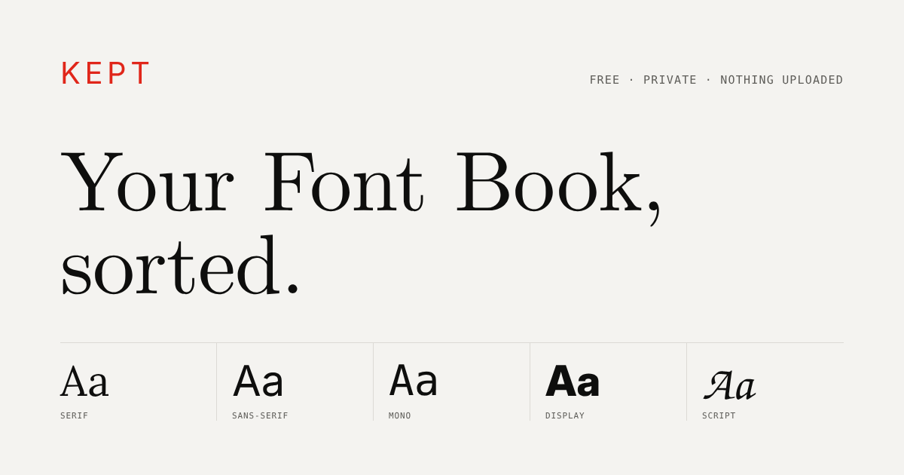
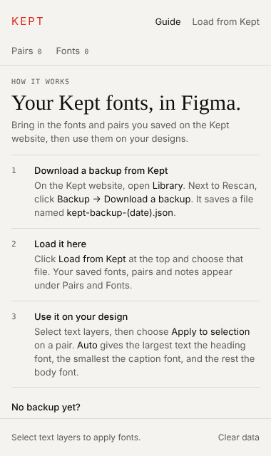
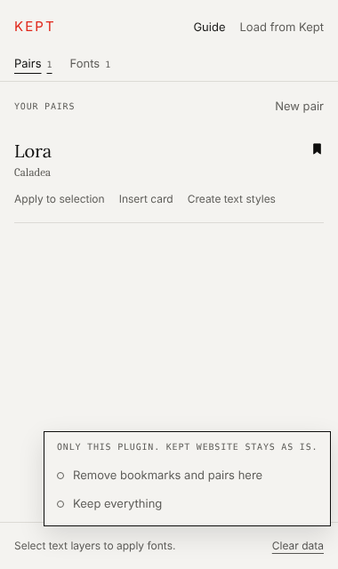

# Kept

Your Font Book, sorted. Kept reads the fonts installed on your Mac, puts them on shelves (serif, sans-serif, mono, display, script), lets you go through them shelf by shelf, and gives you a Playground to try them together.

**Try it:** https://kept.ellakimyun.workers.dev



## Why I built it

I started out thinking designers needed a better place to store fonts. Then I interviewed 11 designers, and none of them could recall their favorite fonts. The real problem was remembering the right font when you need it, so Kept is built around sorting, bookmarking and pairing fonts you can find again.

I designed Kept in Figma and built it with Claude. I made a 79-variable token system first, so the Figma file and the code share the same design tokens. In testing, Kept sorted 1,601 fonts onto shelves with 99.5% accuracy, and I kept shipping updates as designers gave feedback.

## Kept for Figma

Bring your saved fonts and pairs into Figma, apply a pair to text layers, or turn it into text styles. See [`figma-plugin`](figma-plugin/) to try it.

<p>
  
  
</p>

## Privacy

Everything runs in the browser. Fonts are never uploaded, and there is no server or account. Bookmarks, pairs and sorting progress are saved in the browser. **Backup** in the library downloads them as a file that can be restored anywhere.

## Browser support

| Browser | Works how |
|---|---|
| Chrome or Edge on a computer | Full import of every installed font (Local Font Access API) |
| Safari, Firefox | Drop or choose font files; installed fonts can't be read |
| Phones | Choose font files; the full import needs a computer |

The page must be served over HTTPS (or `localhost`) for the font permission to work.

## Files

| File | What it is |
|---|---|
| `index.html` | The whole app: markup, styles and script |
| `favicon.svg`, `favicon-32.png`, `apple-touch-icon.png` | Icons |
| `og.png` | Share preview image (1200 × 630) |
| `i1-guide.png`, `i2-clear.png` | Screenshots of the Figma plugin |
| `figma-plugin/` | The Kept plugin for Figma |

## Run it locally

```sh
python3 -m http.server 8000
# open http://localhost:8000 in Chrome
```

## Deploy

Any static host works, with no build step. The publish directory is the repository root.

- **Cloudflare Pages:** Workers & Pages → Create → Pages → Connect to Git → pick this repo. Leave the build command empty and set the output directory to `/`.
- **Netlify:** Add new site → Import from Git → pick this repo. Leave the build command empty and set the publish directory to `/`.

### Custom domain

In the host's dashboard, open the site → Custom domains → add your domain, then follow the DNS record it shows you. HTTPS is set up automatically.

Live at https://kept.ellakimyun.workers.dev. If you add a custom domain, update `og:image`, `og:url` and the canonical link in `index.html` to the new address.
